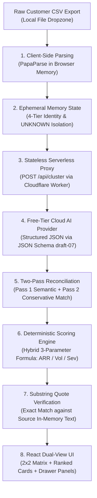

# SIFT — System Architecture Document

**Document Version:** 1.0.0  
**Date:** 2026-10-09  
**Status:** Baseline Scaffolded (Gate G-A4)  
**Governing Documents:** AGENTS.md, MDD v2.0.1, PRD v2.0, DECISIONS.md (`DEC-STACK (APPROVED)`)

---

## 1. System Overview

SIFT is an ephemeral, client-side, browser-based AI product feedback prioritsation workspace for B2B SaaS teams. It ingests unstructured, multi-channel customer feedback CSV exports, normalises data locally in browser memory, performs token-aware two-pass semantic clustering via a stateless serverless proxy to a free-tier cloud AI provider, calculates deterministic hybrid weighted priority scores, enforces exact verbatim receipt verification, and renders an interactive dual-view workspace (2x2 spatial matrix + ranked card list).

### Core Architectural Invariants
1. **Zero Database / Purely Ephemeral:** Zero persistent database (SQL/NoSQL/LocalStorage) exists in the application (`DEC-001`). All feedback rows, clusters, and scores reside exclusively in browser session memory. Closing the tab or clicking "Start New Analysis" flushes all state (`PRD §9.4`).
2. **Stateless Serverless Proxy:** Client never holds private AI provider API keys (`DEC-007`). A stateless serverless proxy (`Cloudflare Workers` free tier per `DEC-STACK`, `DEC-008`) forwards token-efficient batch payloads, enforces strict CORS and 2MB payload limits, and performs zero payload logging (`IC-011`).
3. **Exact Verbatim Receipts:** Every quote displayed in evidence drawers is validated via client-side exact substring match against the raw CSV text in browser memory (`DEC-004`, `IC-001`). Paraphrased or altered text is flagged `Unverified`.
4. **Deterministic Prioritisation:** Score calculation is mathematical and deterministic (`DEC-002`). Interactive slider adjustments re-rank cards at 60 FPS while 2x2 matrix plot coordinates remain fixed (`DEC-010`).
5. **Zero Additional Spending:** The system operates strictly within verified free-tier allowances (Cloudflare Workers 100k requests/day, Google AI Studio free tier; target budget ₹0 / $0.00).

---

## 2. Workspace & Folder Map

The repository is structured to separate concerns while maintaining strict TypeScript type-safety and isolation across the ephemeral data pipeline:

```
sift/
├── api/                        # Serverless proxy routes (Cloudflare Workers)
│   ├── health.ts               # Healthcheck endpoint (GET /api/health)
│   └── cluster.ts              # Future batch proxy endpoint (POST /api/cluster)
├── docs/                       # Project documentation & governance
│   ├── ARCHITECTURE.md         # This architectural specification
│   ├── COST_LOG.md             # Free-tier audit and hosting quota logs
│   ├── DECISIONS.md            # Architecture, product, and sprint decision records
│   ├── PREFLIGHT.md            # Preflight toolchain, environment, and plugin audit
│   ├── SPRINT_STATUS.md        # Real-time task, gate, and blocker status tracking
│   └── TEST_RESULTS.md         # Test traceability matrix (TS-001 through TS-038)
├── fixtures/                   # Static test data & edge-case CSV files
├── scripts/                    # Operational tooling & repository safety scripts
│   ├── secret-scan             # Secret detection CLI launcher
│   └── secret-scan.js          # Secret scanner (zero-leak regex & git search)
├── src/                        # Client-side React SPA (Vite + TypeScript)
│   ├── ai/                     # Two-pass clustering client logic & backoff retries
│   ├── identity/               # 4-tier identity isolation & UNKNOWN tier handling
│   ├── ingest/                 # PapaParse CSV parser & dropzone limits
│   ├── outputs/                # Markdown deliverable generators (PM & Dev specs)
│   ├── scoring/                # Deterministic 3-parameter priority scoring engine
│   ├── types/                  # Shared TypeScript interfaces & JSON schemas
│   ├── ui/                     # React components, 2x2 matrix, and Vanilla CSS tokens
│   ├── verify/                 # Exact client-side substring verification engine
│   ├── App.tsx                 # Root application shell & workflow state
│   ├── index.css               # Design tokens, CSS variables, typography & layout
│   └── main.tsx                # Client entry point
├── tests/                      # Automated test suites (Vitest)
│   ├── e2e/                    # End-to-end user journey test harnesses
│   ├── integration/            # Multi-module pipeline integration tests
│   └── unit/                   # Deterministic unit tests (math, parsing, verification)
│       └── smoke.test.ts       # Baseline skeleton smoke test
├── .env.example                # Names-only environment variable template
├── .gitignore                  # Git ignore rules (.env, dist, node_modules, logs)
├── AGENTS.md                   # Agent orientation, standing contract & IC-001..016
├── index.html                  # SPA HTML entry point
├── package.json                # Pinned dependencies & scripts (dev, build, test, lint)
├── package-lock.json           # Single pinned lockfile
├── tsconfig.json               # TypeScript strict configuration
├── vite.config.ts              # Vite bundler configuration
└── vitest.config.ts            # Vitest test runner configuration
```

### Module Responsibilities

| Directory | Purpose & Key Responsibilities | Linked PRD / Dec |
|:---|:---|:---|
| `src/ingest/` | Client-side CSV ingestion via PapaParse; drag-and-drop dropzone; enforce 10MB file and 2,000-row limits; file format validation. | `REQ-001`, `REQ-002` |
| `src/identity/` | Schema detection; assign unique `Feedback ID` (`FB-001`); differentiate 4 identity tiers (`Feedback ID`, `User ID`, `Account ID`, `Cluster ID`); isolate missing tier/ARR as `UNKNOWN` (1.0x weight multiplier); distinct-row deduplication (`IC-012`); data quality warning banner (>5% missing metadata). | `REQ-003`, `REQ-004`, `DEC-003`, `IC-002`, `IC-012` |
| `src/ai/` | Token-aware batching (50 rows/~8,000 tokens); serverless proxy communication; client-side category grouping (Pass 1); cross-batch reconciliation (Pass 2: `MERGE` $\ge 0.85$, `UNCERTAIN` $0.60\text{–}0.84$, `KEEP_SEPARATE` $< 0.60$); exponential backoff with jitter on HTTP 429/503; fallback to unclustered feedback on terminal batch failure (`PRD §5.8`, `IC-015`). | `REQ-005`, `REQ-006`, `DEC-009`, `IC-003`, `IC-008`, `IC-015` |
| `src/scoring/` | Deterministic priority score computation: $P_c = \text{Round}_1(100 \times [W_{\text{ARR}} \cdot I_n + W_{\text{Vol}} \cdot F_n + W_{\text{Sev}} \cdot S_n])$; slider weight calibration (defaults 40/40/20); fixed matrix plot coordinates $(F_n, I_n)$; dynamic 60 FPS re-ranking of cards. | `REQ-008`, `REQ-009`, `DEC-002`, `DEC-010` |
| `src/verify/` | Client-side exact substring receipt verification against raw CSV in memory; verified/unverified badge states; 5-tier safety decoupling (Observation, Quote, AI Root-Cause Hypothesis, Investigation); inject `[NEEDS INVESTIGATION: Technical Context Missing in Source Feedback]` placeholders. | `REQ-007`, `REQ-011`, `DEC-004`, `DEC-005`, `IC-001` |
| `src/outputs/` | Copy-ready Markdown deliverable generation: Strategic Rationale for PMs and Engineering Spec for Developers (`REQ-012`). (P1 CS Advisory draft generation deferred). | `REQ-012`, `IC-013` |
| `src/ui/` | Dual-view workspace: 2x2 Spatial Priority Matrix with exact quadrant labels (`IC-014`), ranked card list, interactive sliders, data quality banner, deep-dive drawer panels. Vanilla CSS design system (tokens, glassmorphism, responsive viewports). | `REQ-010`, `IC-014` |
| `src/types/` | Central TypeScript interfaces: `FeedbackRow`, `IdentityMapping`, `Cluster`, `ScoreParams`, `PriorityScore`, `VerificationResult`, `DeliverableConfig`. | All |
| `api/` | Cloudflare Workers serverless proxy functions: strict CORS validation, 2MB payload cap, IP rate throttling (10 RPM/IP), AI API key isolation, zero payload logging. | `REQ-013`, `DEC-008`, `IC-010`, `IC-011` |
| `tests/` | Vitest test suites covering unit math, schema mapping, receipt verification, proxy contract, and end-to-end user journeys (`TS-001` through `TS-038`). | `PRD Part XII` |

---

## 3. Data Flow (PRD §9.1)

The complete end-to-end data lifecycle progresses through eight discrete stages, strictly bounded within browser memory and protected by the serverless proxy:



### Detailed Pipeline Stages

1. **Client-Side Parsing (`src/ingest/`):**
   - User drops CSV file ($\le 10\text{ MB}$, $\le 2,000$ rows).
   - PapaParse parses the file directly in browser memory without any network transmission.
   - Assigns unique sequential identifiers (`FB-001`, `FB-002`, ...).

2. **Ephemeral Memory State & Identity Normalisation (`src/identity/`):**
   - Headers auto-detected and mapped to canonical schema (Feedback Text, Customer Tier/ARR, Account ID, User ID).
   - Missing tier or ARR metadata isolated as `UNKNOWN` with a neutral $1.0\times$ weight multiplier (`DEC-003`, `IC-002`). Never defaulted to $0 or Free.
   - Dual-reporting computed: `Confirmed` unique accounts vs. `Estimated` row count (`IC-012`).
   - If missing metadata exceeds 5%, an amber Data Quality Warning Banner is rendered.

3. **Stateless Serverless Proxy Dispatch (`api/`):**
   - Feedback rows chunked into token-aware batches (50 rows per batch, $\sim 8,000$ tokens per request).
   - Batch dispatched via HTTPS POST to `/api/cluster` (`PRD §9.2`).
   - Cloudflare Worker validates CORS origin, enforces 2MB payload cap, and throttles rate (10 RPM/IP).
   - Proxy attaches server-side secret `AI_API_KEY` (never visible to client) and relays request.
   - Proxy maintains zero persistent logs of payload content (`IC-011`).

4. **Free-Tier Cloud AI Inference (`Cloud Provider`):**
   - AI provider generates structured JSON response adhering strictly to `http://json-schema.org/draft-07/schema#` (`IC-004`).
   - Output extracts functional problem statements, root-cause hypotheses, severity ratings ($S_n$), and verbatim quote excerpts.

5. **Two-Pass Client Reconciliation (`src/ai/`):**
   - **Pass 1:** Client groups feedback items into initial batch-level candidate clusters.
   - **Pass 2:** Conservative cross-batch reconciliation evaluates candidate cluster pairs:
     - Similarity $\ge 0.85 \rightarrow$ `MERGE` into unified cluster.
     - Similarity $0.60\text{–}0.84 \rightarrow$ `UNCERTAIN` (flags both clusters: *"Uncertain Cluster — Review Recommended"*).
     - Similarity $< 0.60 \rightarrow$ `KEEP_SEPARATE`.
   - On unrecoverable API failure (after 3 exponential backoff retries), unclustered rows are routed to the `Unclustered Feedback` bucket; raw data is 100% preserved (`IC-015`).

6. **Deterministic Scoring Engine (`src/scoring/`):**
   - Normalized impact score ($I_n \in [0, 1]$) computed from customer tier weights (`Enterprise 3.0`, `Pro 2.0`, `Free/UNKNOWN 1.0` per `IC-002`).
   - Normalized frequency score ($F_n \in [0, 1]$) computed from distinct-row account frequency (`IC-012`).
   - Severity score ($S_n \in [0, 1]$) derived from functional blockage assessment.
   - Priority score evaluated: $P_c = \text{Round}_1(100 \times [W_{\text{ARR}} \cdot I_n + W_{\text{Vol}} \cdot F_n + W_{\text{Sev}} \cdot S_n])$.
   - Default weights: $W_{\text{ARR}} = 0.40$, $W_{\text{Vol}} = 0.40$, $W_{\text{Sev}} = 0.20$.

7. **Substring Quote Verification (`src/verify/`):**
   - For every quote presented in evidence drawers, client executes exact verbatim substring search against the raw CSV text stored in memory (`IC-001`).
   - Exact match $\rightarrow$ Green `Verified` badge.
   - Modified/paraphrased text $\rightarrow$ Yellow `Unverified` warning badge.
   - Missing technical context automatically receives `[NEEDS INVESTIGATION: Technical Context Missing in Source Feedback]` (`DEC-005`).

8. **React Dual-View UI Presentation (`src/ui/`):**
   - **2x2 Spatial Matrix:** Plotted at fixed coordinates $(F_n, I_n)$ across four quadrants with exact labels (`IC-014`):
     - Top-Right: `High Revenue Risk / High Volume`
     - Top-Left: `Enterprise Risk / Low Volume`
     - Bottom-Right: `Mass Friction / Low ARR`
     - Bottom-Left: `Low Priority`
   - **Ranked Insight Cards:** Cards sort dynamically based on calculated $P_c$ as sliders are manipulated at 60 FPS (`DEC-010`).
   - **Drawer Panels & Deliverables:** Slide-over detail view exposing receipts, root cause hypotheses, and copy-ready Markdown specs for PMs and Developers (`src/outputs/`).

---

## 4. Deferred Scope & Features

Per the **P0 Priority Scope Gate** (`AGENTS.md §2, §4.2`) and frozen discovery decisions, the following features and integrations are explicitly deferred:

| Feature / Capability | Classification | Current Status | Justification / Authority |
|:---|:---|:---|:---|
| **Persistent SQL / NoSQL Database** | Architectural Exclusion | Deferred indefinitely / Excluded from MVP | In-memory ephemeral processing eliminates storage costs, privacy leaks, and database infrastructure overhead (`DEC-001`, `PRD §9.4`). |
| **Direct Write-Back Integrations (Jira, Linear, Intercom)** | Product Integration | Deferred to Post-MVP (P2) | Focus is on core discovery and mathematical prioritization; copy-ready Markdown deliverables serve workflow integration (`DEC-006`). |
| **Paid Third-Party Data Enrichment APIs** | Infrastructure Exclusion | Deferred indefinitely / Excluded | Strict ₹0 additional spending constraint (`MDD v2.0.1`, `PRD §15.1`). |
| **Customer Success Advisory Generator** | Feature Scope | Deferred to P1 Polish | P0 deliverables are fully independent of P1 (`IC-013`). Draft generation with mandatory engineering review disclaimer will be built in P1. |
| **Cross-Batch Deduplication Visualizer** | Feature Scope | Deferred to P1 Polish | Visual reconciliation graph deferred to P1 (`IC-013`); conservative two-pass backend logic is implemented in P0. |
| **On-Device Local AI Fallback (e.g. WebLLM)** | AI Strategy | Prohibited / Rejected | Prohibited by `IC-015`. Fallback mechanism routes unclustered feedback to raw data view rather than loading multi-GB client models. |
| **Automated Browser Tool QA** | Test Methodology | Replaced by Manual Inspection Fallback | Antigravity IDE browser driver download fails due to upstream CDN 404. Founder approved manual inspection checklist fallback `DEC-PF03` for UI visual gates. |
| **AI Inference Provider Selection** | Provider Verification | Marked `REQUIRES VERIFICATION` | Pending execution of 4-step Google AI Studio smoke test `TS-018` with founder API key (`PRD §10.1`, `OPT-002`, `AG-PF-07`). |

---

*Governed by AGENTS.md Standing Contract. Any architectural change requires founder approval.*
